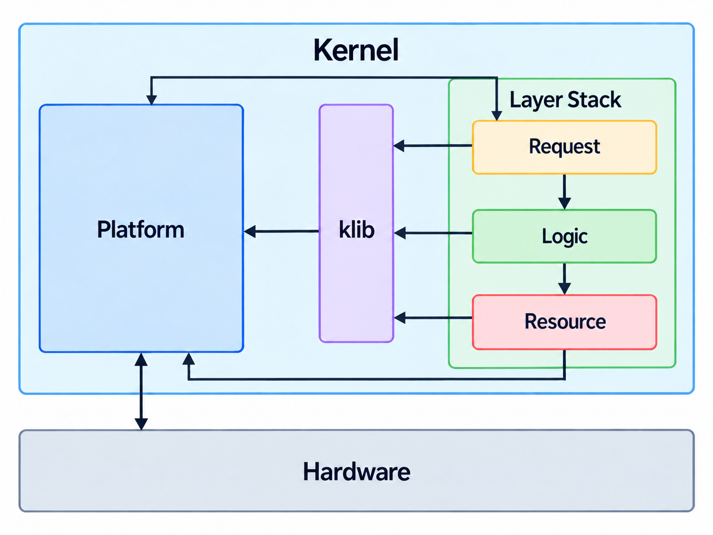

# Arx
Multiarch 64 bit Kernel in development

Targets:
- x86_64 (currently supported)
- aarch64 (experimental)

## Design



Design in order of initialization

Platform
- Architecture specific initiliztion
- Sets up klib
- only part that accesses hardware directly

klib
- contains kernel stdlib
- only access platform for memory allocation functions (kmalloc/vmalloc)

Layer stack
- layers can only access the layer right bellow them using the layers import caps
- lower layers cannot access layers above
- protected by the fact the layers will only have caps struct of layers bellow them

Resource
- Kernel resource manager
- Manages any resources/objects that the kernel owns
- Accesses hardware via platform

Logic
- main logic of kernel
- gets hardware/kernel resources from resource layer
- decides what to do with resources

Request
- interface for kernel request from syscalls or interrupts

Dispatcher
- *not imaged
- how platform will access layer stack

### Platform Setup
- Limine Bootloader loads kernel and sets entry point to _start in arch_entry.c
- arch_entry processes Limine requests, formats it to fit Arx boot protocol in boot.h then passes it to kernel_bootstrap in bootstrap.c
- Arx boot protocol needs 
    - Memory map
    - Framebuffer 
    - Higher half direct memory
    - Paging with no user access and RWX 
    - ACPI rsdp address
    - SMP setup 
- kernel_bootstrap will initialize kernel subsystems

### Platform


- platform variable which stores important global and per cpu platform data structures
- Type is `platform_t` defined in `kernel/platform/platform.h`
- index by arch cpu id
- NOTE: In diagrams platform is named as Dispatcher

### Memory Management

Physical memory managment


- Zone is built from boot memory map
- Currently only one Numa node and zone but gives us space to scale into suporting Non Uniform Memory Access and different memory zones

Allocations | pmm_alloc(size)




Frees | pmm_free(addr)




Virtual memory managment
- page table managment apis (map/unmap/protect)
- each arch implements paging api
- x86_64 paging uses a shared page-table walker for map/unmap/protect on both single-page and range paths
    - keeps page-table traversal behavior consistent across operations
    - range functions batch work to avoid redundant table walks and reduce flush overhead
- smp sync on x86_64 includes TLB shootdown for CPUs running the same active page table
    - local core performs invlpg or non-global CR3 reload depending on change type
    - remote cores receive an IPI request with typed request data (single-page or range invalidation)
- vmm paging apis are wrappers over arch specific implmentation that lock on address space

Virtual address space management
- uses canonical addressing
- on vmm init we init the initial address space by subtracting hhdm, framebuffer, and kernel form the kernel address space

Virtual address space structure


Reserve region in address space



Free region in address space



Heap structure


Heap Alloc



Heap Free


    
Klib allocations
- vmalloc and vfree
    - uses pmm and vmm api to allocate large contiguous virtual memory chunks
    - slow due to needing to map pages
- kmalloc, kzalloc, kfree
    - uses heap api to allocate fast small blocks of contiguous memory
    - fast due to not needing to map pages

### SMP init
- Limine provides SMP cpu list and bsp id through the boot info
- BSP runs arch_smp_init(boot_info) after base kernel init in kernel_bootstrap
- arch_smp_init walks all cpus and skips the BSP
- each AP gets goto_address = smp_entry set from its Limine SMP record
- AP enters smp_entry and then calls smp_platform_init
- smp_platform_init runs per-core arch init


### Arch Init
ran on each smp core
- x86_64
    - build and install 64 bit GDT for kernel and user segments including a TSS
    - initialize per cpu TSS rsp0/ist1 and io bitmap base for user -> kernel transitions
    - initialize per cpu syscall msrs (efer.sce, star, lstar, fmask, kernel gs base)
    - expose arch_enter_user_mode to iretq into cpl3 using user cs/ss and controlled rflags
    - syscall entry path switches from user rsp to per cpu kernel syscall stack then dispatches
    - build and install IDT all isrs call a common isr handler and jumps to c code ISRHANDLER passing regs
    - get madt from acpi using uacpi (bsp only)
    - get per core lapic info from madt
    - init lapic per core
    - init per core lapic timer
    - init global ioapic on bsp only (masking all entries)
    - get iso overides from madt
    - route legacy irqs to bsp lapic
    - expose api to mask/unmask vectors, register new vectors, and route vectors
- General
    - set cpu stack and jump to kernel_bootstrap_complete

### Post Platform Init
currently all cores wait for the rest of the cores to enter post init then continue.

## Kernel Software Stack
- Resource
    - Task manager
        - Owns task objects and task lifecycle
        - Allocation, creation, cleanup
    - Process manager
        - Owns process objects and process lifecycle
        - Tracks process task membership and address space
        - Owns process file descriptor tables
    - Resource filesystem
        - Backend filesystem operations (mount, lookup, read, write)
        - Returns opaque backend node handles

- Logic
    - Scheduler and kernel execution policy
    - ProcessController
        - Process creation, execution, waiting, groups and sessions
        - Process memory mapping, protection and program break policy
        - Implemented in `ProcessLifecycle.cpp` and `ProcessMemoryManager.cpp`
    - Virtual filesystem semantics (paths, dentries, mounts, open files)
    - ElfMapper
        - Reads ELF metadata from VFS files
        - Maps PT_LOAD segments into process address spaces via Resource capabilities
- Request
    - Entry layer for syscalls/interrupt-driven kernel requests
    - Managers currently in tree:
        - ProcessRequestManager
        - SchedulerRequestManager
        - TimeRequestManager
        - MemoryRequestManager
        - VfsRequestManager
        - EventRequestManager
        - SyncRequestManager
        - SignalRequestManager
        - CredentialRequestManager
        - SystemRequestManager
        - SocketRequestManager

    ### Interrupt Scheduling
    - `InterruptRequestManager` handles arch-independent interrupt request numbers (for example schedule request `1`).
    - x86_64 timer interrupts are translated into this request and routed through Dispatcher into Request layer.
    - Schedule requests are tick-gated (`SCHEDULE_TICK_INTERVAL`) to avoid switching every timer tick.
    - On schedule request, current process is re-queued on its CPU ready queue and scheduler runs the next ready process.

## Processes
- Tasks
    - unit of schedulable cpu execution
    - contain stack and task function
    - holds cpu context
- Process
    - stores tasks part of process
    - storess address space

### Filesystem
- Resource owns backend filesystem access (mount, lookup, read, write).
- Logic owns VFS behavior (path resolution, dentries, mounts, open files).
- Resource returns opaque backend handles.
- Logic wraps them into VFS objects (`inode_t`, `dentry_t`, `mount_t`, `file_t`).

Current backend:
- `cpio` initramfs via `ResourceFileSystem`.

Flow:
1. Kernel creates Resource and Logic layers.
2. Logic mounts root filesystem through Resource.
3. Resource provides root backend node.
4. Logic builds root VFS mount/namespace.

### ELF Loading

`ElfMapper` lives in Logic. Call `ReadElf(file, metadata)` first, with
zero-initialized metadata, then either:

- `LoadExecutable(process, file, metadata)` maps the main executable and sets
  its initial heap break.
- `LoadLibrary(process, file, metadata, requestedLoadBias = 0)` maps an `ET_DYN`
  image without changing the heap. Zero selects a free aligned image span;
  a nonzero bias must fit exactly and satisfy segment alignment.

Both use canonical VFS file backing for compatible file pages, private COW
mappings for writable data, and private zero-filled pages for BSS or mixed
segment pages. Failed loads remove their new mappings. The caller owns the
open file and metadata (including `metadata.segments`); successful mappings
retain backing independently until unmap, exec, or address-space destruction.
Loading a file twice creates separate virtual mappings sharing clean pages.
Address selection is deterministic; it does not implement ASLR.

On x86_64, exec maps `PT_INTERP` through `LoadLibrary`, supplies the executable's
program headers, entry point, interpreter base, argv/envp and auxiliary vector,
and enters the userspace interpreter. The interpreter handles `DT_NEEDED`,
symbol resolution, relocations, TLS and constructors through ordinary syscalls.
The kernel does not maintain a second library cache or perform dynamic linking.

Private file `mmap` permits spans beyond EOF as nonresident reservations, which
musl replaces with anonymous BSS pages. These reservations survive fork and
protection changes without gaining physical pages. Shared mappings beyond EOF
remain unsupported. Accessing an unreplaced EOF reservation does not yet deliver
Linux `SIGBUS`; it follows Arx's existing unhandled page-fault path. This is a
bounded ELF/process-startup compatibility milestone, not full Linux ABI support.

### Building and testing (x86_64)

Every image build, including debug builds, requires a musl compiler and runtime.
Defaults are `MUSL_CC=musl-gcc` and
`MUSL_RUNTIME=/lib/ld-musl-x86_64.so.1`. Override these when musl is installed
elsewhere:

```sh
make -j6 MUSL_CC=/path/to/musl-gcc MUSL_RUNTIME=/path/to/libc.so
```

The default build produces the supported x86_64 image. Existing AArch64 targets
remain experimental; this dynamic execution milestone adds no AArch64 support.

The build compiles a PIE executable and shared test library against musl, and
packages them, a static execve launcher, the interpreter, and its license in
initramfs. Missing musl fails the build; execution coverage is never silently
omitted on x86_64. musl is supplied locally rather than downloaded during builds.

Kernel self-tests cover library placement, collisions, exact alignment, rollback,
heap preservation, physical-page sharing after file closure, private writable
state, and nonresident EOF reservation cleanup/replacement/fork. The post-start
`dynamic_interpreter` test executes the launcher through the actual execve syscall,
then runs musl and verifies a shared-library constructor, initialized data, BSS,
symbol relocation and a library function call before successful exit.


## Third Party
- [Limine](https://github.com/limine-bootloader/limine) - Bootloader/protocol used to load the kernel and provide boot info.
- [printf](https://github.com/mpaland/printf) - Small freestanding printf implementation used for kernel logging output.
- [uACPI](https://github.com/uACPI/uACPI) - ACPI implementation used for table parsing and ACPI support.
- [Flanterm](https://github.com/Mintsuki/Flanterm) - fast and reasonably complete terminal emulator
- [musl](https://musl.libc.org/) - required userspace runtime for dynamic ELF self-tests; its license is bundled with initramfs.

All third-party components retain their original licenses.

## AI Usage
- Build system and scripts are AI generated
- selftest.c is AI generated testing of kernel subsystems
- Ai used for refactoring and codebase managment
- Ai implements syscall handlers using layer import caps
