# Diagrams

Editable Mermaid sources for SVGs embedded in the kernel, platform, and
architecture guides.
The rendered SVG files remain in `docs/imgs/`. Render each block with Mermaid CLI,
using `platform-mermaid-config.json` and its listed SVG filename. Keep the guides
using the rendered SVGs rather than inline Mermaid blocks.
Preserve text spacing in exported SVGs with `xml:space="preserve"` on the root element.

## NUMA allocation structure

SVG: `NUMA Node Allocation Flow-2026-04-15-064600.svg`

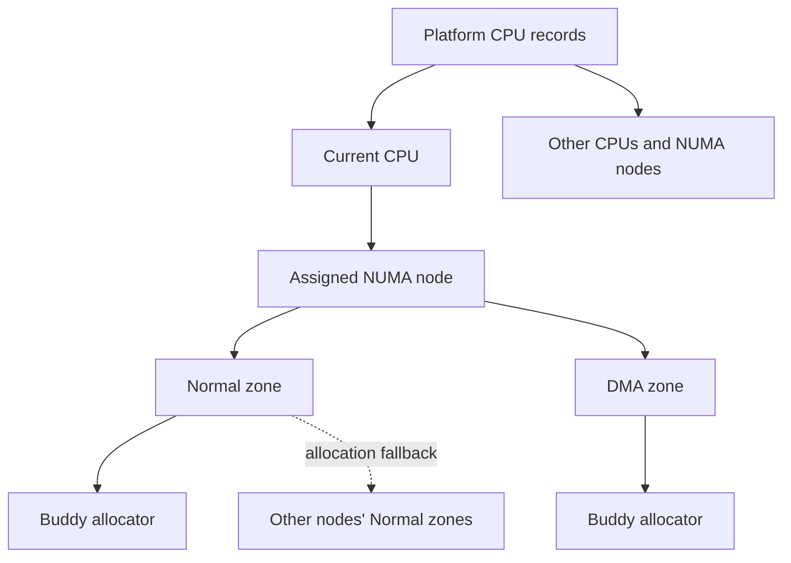

## Physical memory allocation

SVG: `pmmalloc-2026-04-15-065023.svg`

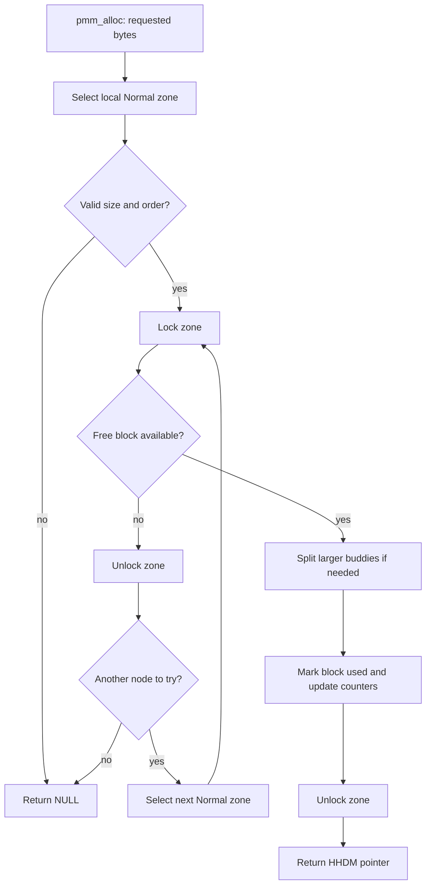

## Physical memory release

SVG: `pmmfree-2026-04-15-065114.svg`

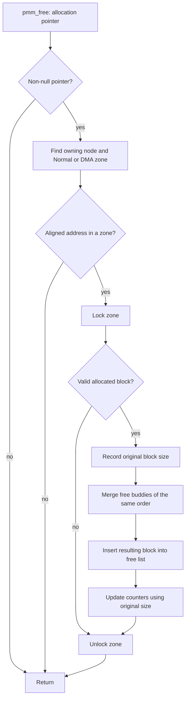

## Platform CPU state

SVG: `dispatcher-2026-04-15-070216.svg`

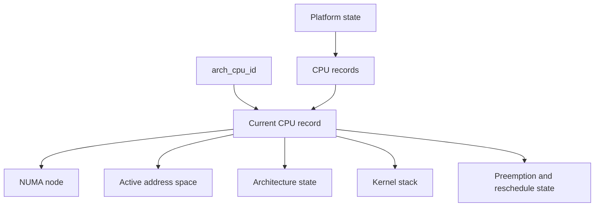

## Virtual region reservation

SVG: `vmmreserve-2026-04-15-072825.svg`

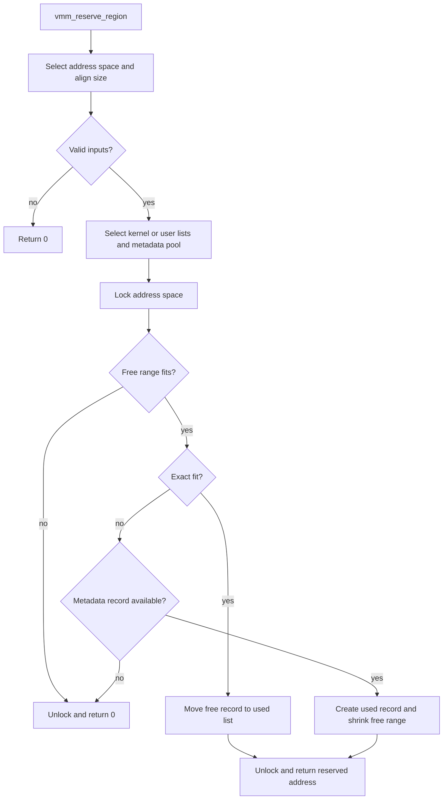

## Virtual region release

SVG: `vmmfree-2026-04-15-072859.svg`

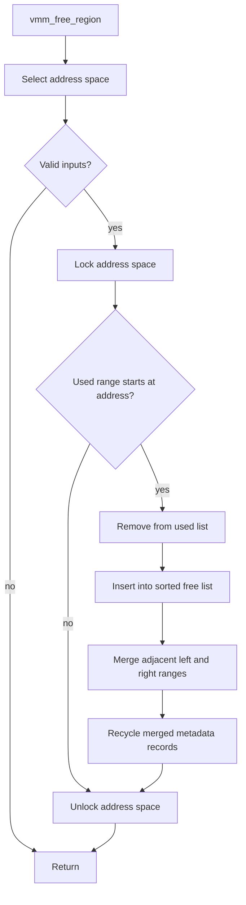

## Virtual address-space structure

SVG: `vaddr-2026-04-15-074940.svg`

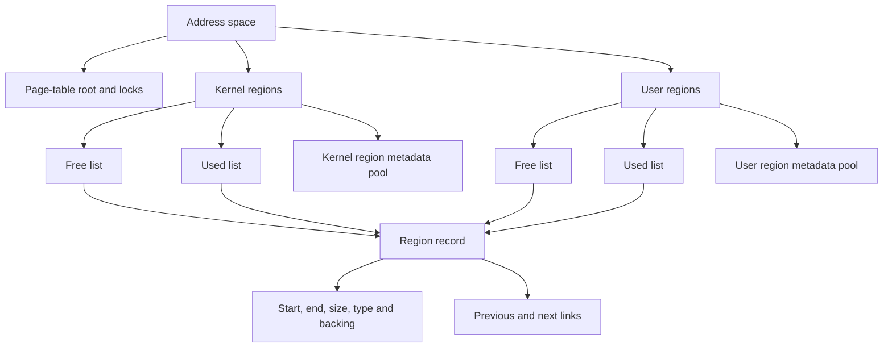

## Heap structure

SVG: `heap-2026-04-19-224905.svg`

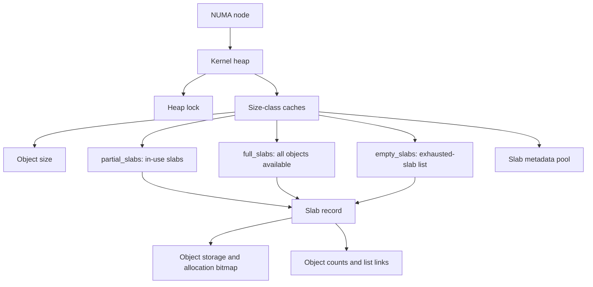

## Heap allocation

SVG: `heapalloc-2026-04-19-225900.svg`

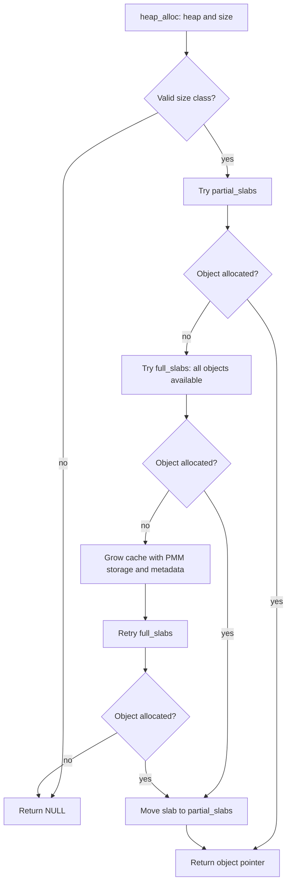

## Heap release

SVG: `heapfree-2026-04-19-225920.svg`

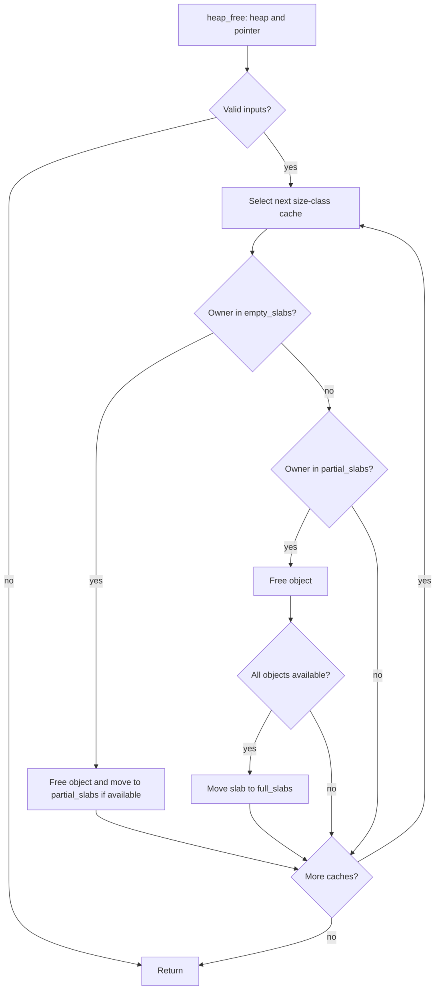

## VFS mount and open flow

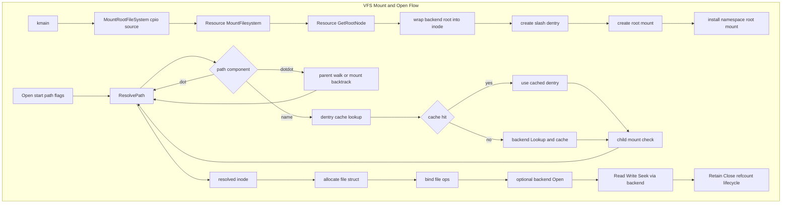

## Kernel architecture responsibilities

SVG: `kernel-architecture.svg`

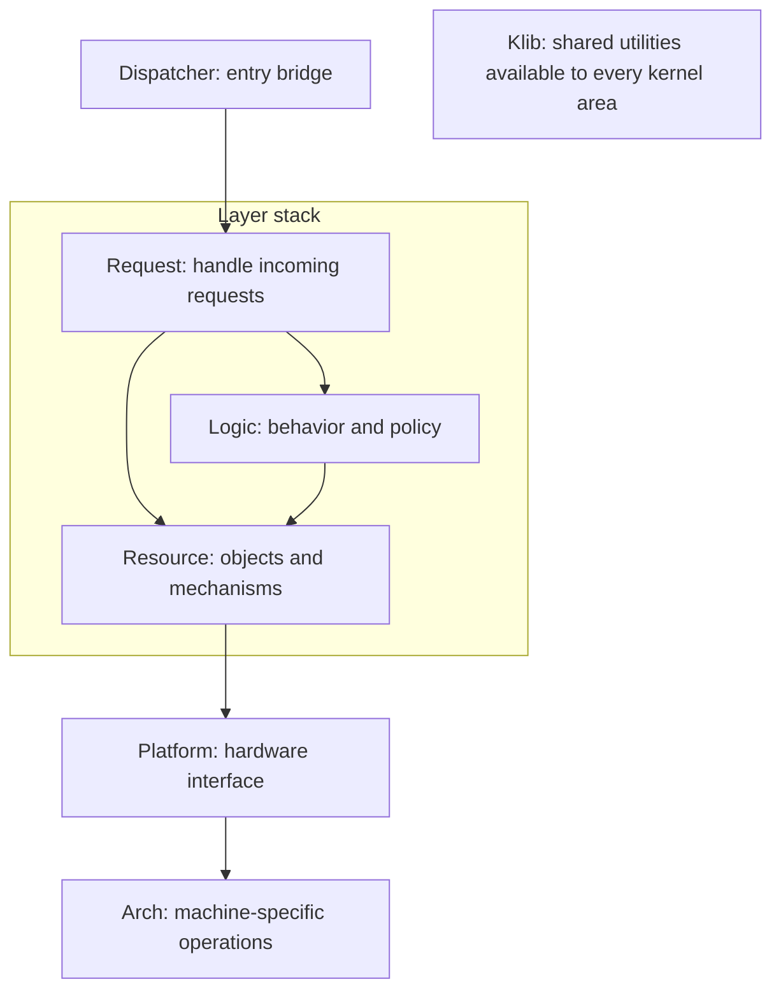

## Kernel initialization order

SVG: `kernel-startup.svg`

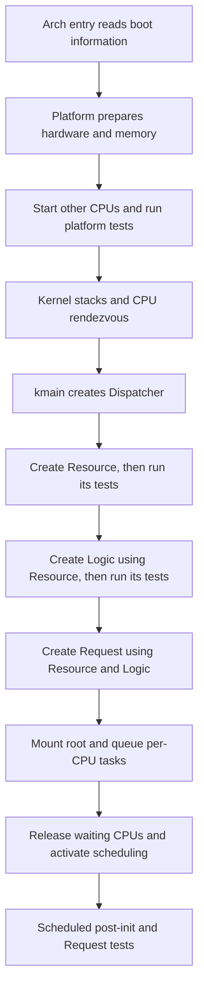

## Kernel request flow

SVG: `kernel-request-flow.svg`

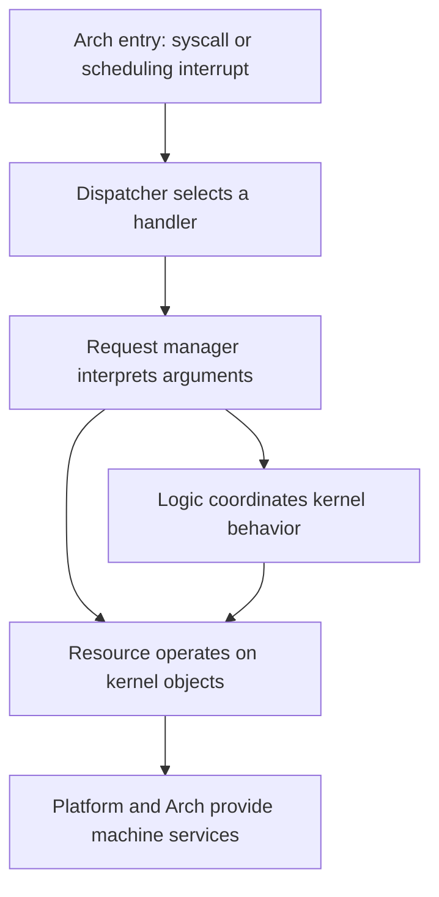

## x86_64 initialization

SVG: `x86_64-initialization.svg`

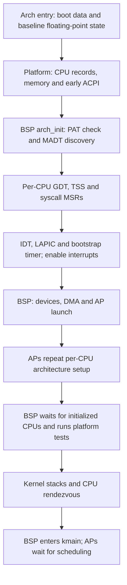

## x86_64 interrupt entry and return

SVG: `x86_64-interrupt-flow.svg`

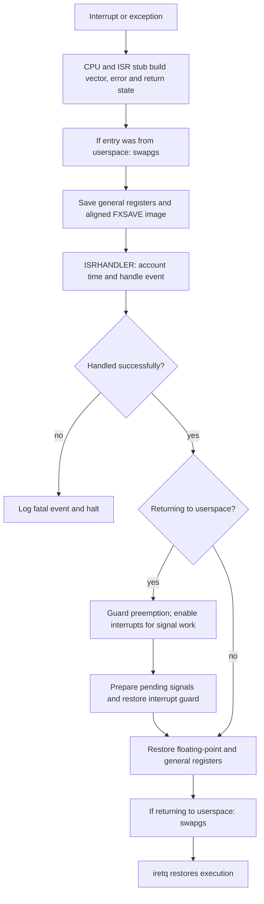

## x86_64 syscall entry and return

SVG: `x86_64-syscall-flow.svg`

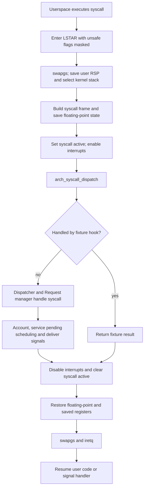

## AArch64 initialization boundary

SVG: `aarch64-initialization.svg`

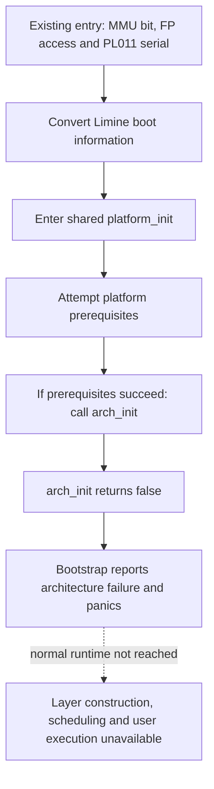
