# Arx kernel architecture

Arx separates hardware support, resource ownership, kernel behavior, and incoming
requests. The sections below follow startup order: architecture entry, platform
setup, shared library services, Dispatcher, and the three layers.

## 1. Arch: enter the kernel

Arch contains the architecture-specific code needed to keep the rest of the
kernel portable. It handles CPU instructions, paging, interrupts, context
switching, and transitions between user and kernel execution.

Startup begins in `arch_entry.c`, which converts Limine boot information into
Arx's boot structures and calls platform initialization. Later, platform and the
layers use the common operations declared in `arch.h`. Reuse those operations
before adding a helper. Interrupt state, idle waits, TLS, syscall state, clone and
exec frame preparation, CPU identifiers, ELF machine selection, and platform
capabilities belong behind this interface. Process and scheduling policy remains
in the layers; unsupported targets report capabilities or unsupported results.

The selected architecture header owns the boot SMP record layout. Compile-time
checks in each architecture's `arch_selftest.cpp` compare it with Limine's ABI.
`arch/selftest.hpp` exposes independent test fixtures for register layouts,
signal frames, executable instruction bytes, and page permissions. Shared tests
keep resource ownership, policy assertions, and cleanup. The bundled
`boot/limine.h` retains its upstream architecture conditionals.

Initialization belongs in each target's `arch_init.c`; runtime operations and
capability helpers belong in `arch_helper.c` or their existing specialized modules
such as paging, syscalls, and signals.

The implementations differ by target. AArch64 support is incomplete: its
`arch_init.c` reports initialization as unsupported, and its runtime task-switching
stubs live in `arch_helper.c`.

## 2. Platform: prepare the machine

Platform is the kernel's hardware interface. It uses Arch for machine-specific
operations and provides CPU state, memory management, the heap, ACPI, device
setup, DMA services, and terminal output.

In `bootstrap.c`, `platform_init` sets up these facilities and starts the other
CPUs. Platform tests run before the CPUs reach `platform_init_complete`. The
bootstrap CPU then enters `kmain`; the others wait for scheduling to begin.

The shared `platform` object, defined by `platform.h`, records machine state and
holds the Dispatcher pointer.

## 3. Klib: shared kernel utilities

Klib is the kernel standard library, available to every kernel area and future
drivers. It provides memory and string functions, allocation, logging, safe
user-memory copies, locks, and common data structures.

Its main interface is `klib.h`. Allocation in `klib.c` uses platform memory
services, so those services must be ready before allocation is available. Simple
helpers can also be used earlier during startup; Klib has no single initialization
step of its own.

## 4. Dispatcher: connect platform to the layers

In `kernel.cpp`, `kmain` creates Dispatcher. Dispatcher is how platform
communicates with the layer stack: it routes syscalls and interrupt requests to
the appropriate handlers.

`Dispatcher.cpp` constructs the layers in this order:

1. Resource, followed by its tests.
2. Logic, using Resource services, followed by its tests.
3. Request, using both Resource and Logic services.

Debug builds also embed DebugManager in Dispatcher for typed, borrowed statistics
records and bounded read-only GDB views. Providers maintain debug-only runtime
records; release builds exclude this storage and tracking work. The debugging
guide describes the foundation interface and current controlled providers.

Each layer's factory creates its managers and publishes a capability structure:
references to the services that other parts of the kernel can use.

## 5. Resource: own kernel resources

Resource owns kernel objects and provides the operations needed to manage them.
`ResourceLayerFactory.cpp` creates the following components, in this order.

| Component file | Responsibility |
| --- | --- |
| `PhysicalMemoryManager.hpp` | Allocates and frees physical memory and reports usage. |
| `ProcessManager.hpp` | Owns process objects, task membership, and process resources. |
| `TaskManager.hpp` | Owns tasks, stacks, execution contexts, and task switching. |
| `VirtualMemoryManager.hpp` | Manages address spaces, virtual mappings, and memory backing. |
| `DmaManager.hpp` | Allocates and tracks coherent DMA memory. |
| `TimeManager.hpp` | Provides clocks, deadlines, and process interval timers. |
| `InitRamFileSystemManager.hpp` | Reads the boot-provided cpio initramfs. |
| `ResourceFileSystem.hpp` | Provides filesystem backend operations and node handles. |

## 6. Logic: decide how resources are used

Logic implements kernel behavior and policy by combining Resource services.
`LogicLayerFactory.cpp` creates these components and connects managers that need
to work together.

| Component file | Responsibility |
| --- | --- |
| `Scheduler.hpp` | Chooses runnable tasks and coordinates sleeping, waking, and scheduling policy. |
| `VirtualFileSystem.hpp` | Manages paths, mounts, directory entries, and open files. |
| `ElfMapper.hpp` | Validates and maps ELF executables and libraries into processes. |
| `CredentialManager.hpp` | Manages user and group identities and permitted identity changes. |
| `EventManager.hpp` | Coordinates readiness waits and event notifications. |
| `SynchronizationManager.hpp` | Implements futex synchronization, priority inheritance, and cleanup. |
| `SignalManager.hpp` | Manages pending signals, signal handlers, delivery, and return. |
| `ProcessController.hpp` | Coordinates process lifecycle and process memory policy. |
| `SocketManager.hpp` | Implements local socket connections and message exchange. |
| `InterProcessCommunicationManager.hpp` | Implements pipes and memory files. |

The ownership split is intentional. ProcessManager owns process objects;
ProcessController coordinates operations such as creation and exit. TaskManager
performs task switching; Scheduler decides which task should run.

## 7. Request: handle incoming requests

Request interprets syscalls and common interrupt requests, checks their arguments,
and calls the required lower-layer services. `RequestLayerFactory.cpp` creates
the following managers.

| Manager file | Responsibility |
| --- | --- |
| `ProcessRequestManager.hpp` | Handles process lifecycle, process IDs, groups, and sessions. |
| `SchedulerRequestManager.hpp` | Handles scheduling policy, priorities, yielding, and CPU affinity. |
| `TimeRequestManager.hpp` | Handles clock queries, sleeps, timers, and alarms. |
| `MemoryRequestManager.hpp` | Handles memory mapping, protection, and program-break requests. |
| `VfsRequestManager.hpp` | Handles file, descriptor, directory, and path operations. |
| `EventRequestManager.hpp` | Handles readiness waits and notification requests. |
| `SyncRequestManager.hpp` | Handles futex operations and robust-list requests. |
| `SignalRequestManager.hpp` | Handles signal configuration, sending, waiting, and return. |
| `CredentialRequestManager.hpp` | Handles user and group identity requests. |
| `SystemRequestManager.hpp` | Handles system information, resource limits, controls, and random data. |
| `SocketRequestManager.hpp` | Handles socket creation, connections, messages, and options. |
| `InterruptRequestManager.hpp` | Handles common interrupt requests, currently for scheduling. |

## 8. Start normal kernel work

Once the layers exist, `kmain` mounts the initramfs through VirtualFileSystem and
Resource's filesystem services. It creates and queues post-initialization tasks
for each CPU, releases the waiting CPUs, and activates scheduling. Those tasks
perform later initialization and tests.

During normal execution, architecture entry code sends syscalls and scheduling
interrupt requests through Dispatcher. Request managers then use the lower layers
to carry out the work.

Scheduling requests are tick-gated by InterruptRequestManager. When the interval
is reached, it wakes sleeping tasks and, if scheduling is active, requeues the
current process and asks Scheduler to run the next ready process.

This follows the bootstrap CPU. Other CPUs initialize in parallel and wait for
scheduling to begin.

## 9. Self-tests: check the kernel as it starts

Self-tests run inside the kernel as their required services become available.
They check individual managers and interactions between kernel components.
`SelfTestManager.cpp` coordinates the test phases and collects results.

| When | What runs |
| --- | --- |
| After platform setup | Platform tests check the underlying machine and memory services. |
| After Resource construction | Resource tests check resource managers. |
| After Logic construction | Logic tests check kernel behavior using Resource services. |
| In scheduled post-initialization tasks | Integration tests exercise work that needs scheduling and multiple CPUs. |
| After the bootstrap CPU's integration tests | Request tests run, followed by the final summary. |

The bootstrap CPU records test cases; other CPUs contribute results from their
integration work. `SelfTestManager.hpp` defines the coordinator, and `selftests.h`
provides its C interface.

Results appear in kernel logs as `PASS`, `FAIL`, `SKIP`, or `BLOCKED`. The final
summary reports `INCOMPLETE` when tests are blocked and no failures were recorded.
Reaching kernel startup alone does not mean all tests have finished.

## Rules for working across boundaries

Arrows show the main service dependencies. Klib is available to every kernel area.

Higher layers may access any lower layer. Request may use both Logic and Resource;
Logic may use Resource. Ordinary dependencies point downward. Necessary upward
operations must pass through Dispatcher; lower layers must not directly call
upper managers or invoke their callbacks. Managers within the same layer can
collaborate, and all kernel areas may use Klib.

Platform owns the hardware interface, with machine-specific operations implemented
in Arch. Some managers call Arch directly, such as TaskManager for context
switching and TimeManager for clock readings.

### Necessary upward routes through Dispatcher

Some resource mechanisms need work owned by Logic. These are explicit exceptions
to the ordinary downward direction, mediated by Dispatcher rather than direct
access to an upper manager.

| Origin and operation | Route | Why it is needed |
| --- | --- | --- |
| TaskManager scheduling accounting | TaskManager → Dispatcher → Scheduler | End the outgoing execution interval and begin the incoming interval at the context-switch boundary. |
| Task priority and retirement cleanup | TaskManager → Dispatcher → SynchronizationManager, with Scheduler policy retirement where needed | Release priority-inheritance ownership, process robust lists, clear child-TID state, and wake affected waiters before task storage is reclaimed. |
| Descriptor-table copying and final release | ProcessManager → Dispatcher → VFS file retain/release | Each copied table needs its own open-file references; the last table owner must close those references through their Logic owner. |

DispatcherBridge.h exposes opaque route handles to Resource. DispatcherRoutes.hpp
defines the immutable provider records used by Logic and self-test fixtures;
their callable fields are private. Resource stores the handles and calls typed
Dispatcher operations, never the upper callbacks themselves. A route and its
context must outlive every task, descriptor table, or pending operation that uses
them. Shared signal records live in signal_types.h; Resource queue storage lives
in SignalState.hpp, so using signal data does not require a Logic manager header.

TaskManager keeps its existing task claims while cleanup runs outside the manager
lock. Descriptor copies retain their source-table protection, and failed copies
release only references already acquired. Dispatcher adds no global routing lock
and does not make these operations safe in a new execution context.

Platform and Klib are outside the layer-stack direction rule. Their entry into
the stack goes through Dispatcher and a Request handler:

| Entry | Request handler and destination |
| --- | --- |
| Klib user-memory begin/end | MemoryRequestManager pins and releases Resource process memory while pairing the address-space lock and preemption guard. |
| Platform pending reschedule | SchedulerRequestManager forwards to Scheduler. |
| Platform minor-fault accounting | MemoryRequestManager updates the active Resource process when its address space matches. |
| Platform file-backing writeback and context release | MemoryRequestManager invokes the backing provider through its opaque route; failures retain backing for retry. |

These kernel-service Request entry methods are stateless and do not require the
full Request factory output. Resource user-copy and backing tests can therefore
run before Logic and ordinary syscall managers are constructed. Operations that
need Logic use its published capabilities and retain their unavailable-service
behavior. Architecture mode-accounting and signal-return bridges likewise route
through the corresponding Scheduler and Signal Request handlers.
