# AArch64 architecture support

AArch64 remains an incomplete port. This guide separates code that exists from
stubbed operations; no AArch64 functionality is implemented as part of this
documentation work. The implemented x86_64 paths are described in x86_64.md.

The shared `arch.h` contract declares the machine operations expected by platform
and the layer stack. An AArch64 declaration or structure does not mean the
corresponding runtime path works.

## 1. Entry code that exists

`arch_entry.c` contains Limine requests, boot-information conversion, and `_start`.
It ensures the MMU-enable bit is set, enables FP/SIMD access, initializes a PL011
serial port at the QEMU-style address, and calls `platform_init`. `linker.ld`
selects the entry point and lays out the kernel image.

Basic CPU helpers use DAIF masking, `wfi`, and `yield`. `arch_cpu_id` returns the
low byte of MPIDR; it does not perform x86_64's hardware-to-logical CPU lookup.
SMP launch code publishes `smp_entry` in Limine CPU records with barriers and
wake events, then enters `smp_platform_init`.

This is existing launch code, not a completed SMP runtime. If earlier platform
setup succeeds, `arch_init` returns false and the bootstrap CPU stops before
normal layer construction and scheduling.

## 2. Paging code that exists

`arch_paging.c` contains four-level, 4 KiB page-table walking, map/unmap/protect
operations, range operations, address translation, and TTBR1 root access.
It checks 48-bit address encodability and uses barriers and TLBI instructions
when changing the active root or its mappings.

Active remapping has a break-before-make path: remove old valid entries,
synchronize, then publish replacements. Table storage comes from PMM and is
accessed through the direct map. These mechanisms still depend on the boot
translation setup and platform memory services.

This is partial paging support. It does not complete isolated userspace roots,
strict user-memory permission checks, or integration with a running SMP scheduler.
No successful AArch64 build or boot is claimed by this source inventory.

## 3. Defined structures

`aarch64.h` provides the following layouts for the common interface:

| Structure | Defined fields and current limitation |
| --- | --- |
| `arch_task_context` | X19–X29, SP, and PC; context initialization and switching are still stubs. |
| `arch_syscall_frame_t` | Syscall number, six arguments, user ELR, SPSR, and SP; no syscall entry/return path fills it. |
| `arch_info_t` | Empty; per-CPU interrupt/runtime architecture state is not implemented. |
| `arch_platform_info_t` | Empty; shared controller/device architecture state is not implemented. |

`arch_set_stack` aligns SP and passes the entry argument in X0 before calling the
entry function. This stack helper is implemented; it is separate from task
context switching.

## 4. Stubbed and unsupported operations

| Area | Current behavior |
| --- | --- |
| CPU runtime initialization | `arch_init` returns false in `arch_init.c`. |
| Task execution | Context initialization/switching do nothing; `arch_task_context_supported` returns false. |
| User entry | `arch_enter_user_mode` calls `panic`; transition-stack updates do nothing. |
| Interrupts and syscalls | No target exception-vector, interrupt-controller, or syscall entry/return implementation is present. |
| Rescheduling and timer programming | Requests do nothing; readiness/programming hooks return false. |
| Isolated user roots | Creation returns zero; destruction does nothing. |
| User-memory permission checks | `arch_user_page_accessible` returns false. |
| Monotonic/realtime clocks | Initialization and monotonic-read hooks return false. |
| Early firmware mapping | `arch_boot_map_physical` returns false. |
| Signals | `arch_signal.cpp` rejects action validation, preparation, and restoration with EOPNOTSUPP; user-return detection returns false. |
| Random seed | `arch_user_random_seed` returns false. |
| Device discovery | `arch_device_init` returns false. |
| Firmware controller setup | `arch_acpi.c` returns success without processing MADT information. |
| DMA | No AArch64 definitions of the DMA capability/barrier hooks are present; bootstrap initializes the platform DMA backend only on x86_64. |

A successful no-op, such as the ACPI hook, must not be treated as implemented
hardware support. AArch64 stays stubbed until these missing runtime paths are
addressed in separate implementation work.

## 5. Inspection and tests

Start with `arch_init.c` for the intentional startup boundary and `arch_paging.c`
for existing paging behavior. `arch_signal.cpp` records the unsupported user
signal operations. Platform.md describes the shared bootstrap dependencies.

`taskcontexttests.cpp` exercises switching and TLS, which require a working
architecture backend; `signalintegration.cpp` skips user-frame tests outside
x86_64. Shared
test code and AArch64 branches do not establish a passing full-port test run.
`debug-kernel.sh` launches AArch64 with plain GDB by default. The
`debug/gdb/arx.py` framework supports x86_64 only; neither debugger workflow
supplies the missing architecture backend.

See [GdbCommands.md](../../debugging/GdbCommands.md) for the supported x86_64
commands, selectors and stopped-target limitations.
