# x86_64 architecture support

The x86_64 implementation supplies the machine operations behind `arch.h`.
Platform uses it to initialize hardware; memory and task managers use it for
paging and execution. Dispatcher connects machine entry paths to kernel behavior.

This guide describes implemented paths and their current limits. KernelArch.md
explains the layer design; Platform.md explains the surrounding platform services.
AArch64 has its own guide, aarch64.md.

## 1. Entry and CPU startup

`arch_entry.c` contains `_start`, the Limine requests, and the boot-information
adapter. Entry ensures paging is enabled, enables baseline x87/SSE support,
starts serial logging, and passes Arx's `boot_info` to `platform_init`.
`linker.ld` selects `_start` and retains the boot requests.

The bootstrap CPU gathers memory, framebuffer, direct-map, firmware, initramfs,
and CPU information. The temporary `boot_info` is consumed during bootstrap;
long-lived machine state is recorded in `platform` and its CPU records.

`arch_cpu_id` matches the CPU's legacy APIC ID against platform's CPU records,
returning a logical index. Before those records exist, it returns zero. For SMP,
`arch_smp_init` publishes `smp_entry` in each non-bootstrap Limine CPU record.
Each secondary CPU enables floating-point support and enters `smp_platform_init`.

### arch_init: prepare the CPU for kernel execution

`arch_init` in `arch_init.c` runs on every CPU after platform memory services are
available. On the bootstrap CPU, early ACPI table access is also ready. It performs
the following setup in order:

1. **Check memory cache attributes.** PAT slot 3 must describe uncached memory,
   as expected by the kernel's device mappings. An incompatible setting returns
   failure rather than changing the meaning of existing mappings.
2. **Discover interrupt controllers on the bootstrap CPU.** `arch_acpi.c` reads
   the MADT to associate local APIC information with CPU records and record the
   shared I/O APIC and legacy IRQ overrides. Secondary CPUs reuse this information.
3. **Install the GDT and TSS.** Each CPU receives kernel/user segments, a kernel
   transition-stack pointer in RSP0, and a dedicated double-fault stack in IST1.
   The code loads the GDT and task register and reloads segment selectors. Until
   a permanent CPU stack exists, RSP0 uses the current stack.
4. **Configure syscall entry.** `arch_syscall.c` sets the entry address, segment
   selectors, entry flag mask, and per-CPU GS state. It records an initial kernel
   stack and enables the syscall instruction. Later task switches update the
   transition stack for the selected user task.
5. **Install and enable interrupts.** The code builds all 256 IDT entries, masks
   the legacy PIC, and loads the IDT. `lapic.c` initializes this CPU's local APIC
   and bootstrap timer. `ioapic.c` configures shared external IRQ routing only on
   the bootstrap CPU, initially masked. Interrupts are enabled after this setup.

The function returns true after completing these steps. PAT or MADT failures can
return false; some controller failures halt directly. This prepares machine entry
paths, while Dispatcher, the layers, and normal scheduling are initialized later.

The diagram follows the bootstrap CPU. Secondary CPUs repeat per-CPU architecture
setup, then join the rendezvous in `platform_init_complete`.

## 2. Per-CPU initialization and structures

`x86_64.h` defines the structures shared by C and assembly:

| Structure | What it holds |
| --- | --- |
| `arch_info_t` | Per-CPU interrupt-controller information, GDT, TSS, IDT, and syscall stack state. |
| `gdt_t`, `tss_t` | Kernel/user segments, the user-to-kernel stack pointer, and the double-fault stack pointer. |
| `idt_entry_t`, `idt_description_t` | Interrupt entry addresses, selectors, gate flags, and the IDT location. |
| `arch_platform_info_t` | Shared I/O APIC state, IRQ overrides, and PCI configuration regions. |
| `registers_t` | Saved interrupt registers, vector, error code, and return state. |
| `arch_syscall_frame_t` | Syscall number, arguments, user return state, saved registers, and floating-point image pointer. |
| `arch_task_context` | Saved task execution state, floating-point image, and user TLS bases. |

GDT, TSS, and IDT storage lives in each platform CPU record. Double faults use a
separate static four-page stack per CPU through IST1. Normal user transitions use
TSS RSP0; task switching updates it together with the syscall kernel-stack pointer.
The selectors are kernel code/data `0x08`/`0x10` and user code/data `0x1b`/`0x23`.

## 3. Paging and TLB synchronization

`arch_paging.c` implements four-level paging with 4 KiB leaf mappings. Page-table
arguments are physical addresses; the walker accesses table memory through the
higher-half direct map. Inputs are checked for alignment, canonical addresses,
range overflow, and encodable physical addresses.

Mapping, unmapping, and protection share a walker and leaf callbacks. Range
operations batch traversal and invalidation. The walker can split existing 1 GiB
and 2 MiB mappings into smaller tables while preserving their mappings and cache
attributes. Allocation failure can leave
earlier leaves of a range changed, so callers must handle failure and cleanup;
range mapping is not an all-or-nothing transaction.

Debug builds expose the repository's four-level, 48-bit canonical VA / 52-bit
encoded PA format through an architecture helper. The GDB memory walker explains
4 KiB, 2 MiB and 1 GiB leaves using retained HHDM bounds and individual RAM entry
reads. It folds ancestor RW/US/NX permissions, without probing CPU capabilities
or claiming actual TLB/control-register state.

Platform VMM wrappers serialize normal changes with the address-space lock.
The architecture hooks do not acquire that lock themselves. Changed user mappings
are invalidated on initialized CPUs running that root; kernel mappings also reach
other initialized CPUs because the kernel half is shared.

Local invalidation uses `invlpg` or a non-global CR3 reload. Global mappings require
page invalidation. Remote invalidation uses a per-CPU IPI mailbox: the sender
locks the target mailbox, the interrupt handler consumes and clears it, and the
sender waits for release. Target CPUs must be able to service interrupts for
this synchronous handshake to finish.

Debug CPU topology reads this stored mailbox and its lock byte without acquiring
the lock. Scheduling IPIs can bypass the mailbox, and a cleared request can leave
stale payload bytes. A TLB payload contains a range and flags, not an address-space
identity or a history of completed invalidations.

User-root creation allocates a private lower half and shares upper-half kernel
tables. `arch_destroy_user_page_table` expects user leaves already removed and
will not destroy the active root. `arch_user_page_accessible` checks permissions
through the page-table hierarchy for safe user-memory copies. Early firmware
mapping uses `arch_boot_map_physical`, reserving table pages from the boot memory
map before PMM publishes them as free RAM.

## 4. Interrupt entry and return

`interrupts.asm` provides 256 stubs. Each normalizes the vector/error-code pair,
saves general registers, and saves a 512-byte floating-point image on an aligned
kernel stack. Entry from userspace uses `swapgs` to select per-CPU kernel state;
entry from kernel execution already has that state active.

Saved interrupt and syscall frames live on the active kernel stack; their
pointers are only valid while that entry is being handled.

The common stub calls `ISRHANDLER` in `interrupt_handler.c` with pointers to
`registers_t` and the floating-point image. The handler accounts execution time,
handles the event, and considers signal delivery before returning to userspace.
Assembly restores state, swaps GS back when needed, and executes `iretq`.

| Event | Implemented handling |
| --- | --- |
| LAPIC timer, vector `0x20` | Rearms the timer, maintains clock sampling, and requests scheduling when safe. |
| IPI, vector `0x21` | Handles mailbox work such as TLB invalidation and services pending scheduling. |
| Spurious vector `0xff` | Returns without sending an end-of-interrupt acknowledgment. |
| User write-protection page fault | Attempts VMM copy-on-write recovery before treating it as fatal. |
| Other unhandled interrupts/exceptions | Logs the event and halts; page faults also print CR2, CR3, and registers. |

Scheduling is deferred while a syscall is active or preemption is disabled.
IPIs needed for memory synchronization can still run. For user-interrupt signal
delivery, the handler enables interrupts with ordinary preemption guarded, then
restores the interrupt state before assembly return.

`lapic.c` implements local interrupt delivery and IPIs. `ioapic.c` routes external
IRQs and serializes its selector/window accesses with a lock. Its shared setup
runs on the bootstrap CPU. The current interrupt model uses xAPIC; x2APIC mode
is explicitly rejected, and device discovery does not supply a general handler
for every device interrupt.

## 5. Syscalls and user entry

`arch_syscall.c` programs EFER, STAR, LSTAR, FMASK, and GS bases on each CPU.
FMASK initially disables interrupts and clears unsafe entry flags. The syscall
instruction enters `arch_syscall_entry.asm`, which switches from user RSP to the
current task's kernel transition stack before enabling interrupts.

| ABI detail | Current layout |
| --- | --- |
| Syscall number and result | RAX. |
| Six syscall arguments | RDI, RSI, RDX, R10, R8, R9. |
| C dispatch argument | RDI points to the saved syscall frame. |
| `arch_syscall_frame_t` size | 176 bytes; checked against assembly. |
| Important frame offsets | Argument 3 at 32; user RIP at 56; extra registers at 96; floating-point pointer at 160. |
| Per-CPU syscall state | Kernel RSP, user RSP, and active flag at GS offsets 0, 8, and 16. |

Entry saves general and floating-point state, marks the syscall active, and calls
`arch_syscall_dispatch`. A test hook may handle fixture syscalls; ordinary requests
pass through Dispatcher. Before user return, the Dispatcher bridge handles
scheduling/accounting and pending signals.

Return disables interrupts, clears the active flag, restores the saved image,
uses `swapgs`, and executes `iretq`. This implementation does not use `sysret`.
Interrupts are enabled during C dispatch so remote TLB work is not blocked while
syscall code takes memory-management locks.

Initial user entry checks that RIP and RSP are in the low user half and that RSP
is 16-byte aligned. `arch_context.asm` builds an `iretq` frame with controlled
flags and user selectors, passing the two entry arguments in RDI and RSI.
Clone tasks instead resume a copied syscall frame
through `arch_resume_user_frame`, returning zero in the child.

## 6. Task context switching

TaskManager owns task contexts and kernel stacks; Scheduler chooses the work.
`arch_context.asm` saves the outgoing context and restores the incoming context.
It follows the C calling convention for a suspended function call rather than
using the interrupt register layout.

| Context field | Byte offset |
| --- | --- |
| RBX, RBP, R12–R15 | 0–40. |
| RIP, RSP, RFLAGS | 48, 56, 64. |
| 16-byte-aligned FXSAVE image | 80; 512 bytes. |
| User FS base and user GS base | 592 and 600. |

New contexts start at a trampoline with the entry function in R12 and its argument
in R13. During a switch, interrupts are disabled, kernel GS stays active, and
`task_context_switch_complete` runs on the incoming stack before registers and
interrupt flags are restored. Only then is the outgoing stack safe for retirement.
TaskManager also transfers preemption/syscall state and updates user transition
stacks. TLS state follows the task even when it resumes on another CPU.

Floating-point preservation covers baseline x87/SSE using FXSAVE/FXRSTOR.
Entry explicitly clears OSXSAVE; extended XSAVE/AVX task state is not implemented.

## 7. Signal frames

SignalManager owns signal policy; `arch_signal.cpp` owns the x86_64 user-context
layout. It can prepare delivery from a syscall frame or adapt an interrupt frame
to the same representation before user return.

Shared action, alternate-stack, and sender records are defined in signal_types.h.
The architecture implementation consumes that data contract without including
the Logic manager header; machine-specific signal frames remain in `arch/`.

| Structure | Size and purpose |
| --- | --- |
| `signal_context_t` | 256 bytes of user register state and floating-point pointer. |
| `signal_ucontext_t` | 304 bytes, adding stack settings and the saved mask. |
| `signal_frame_t` | 440 bytes, containing the restorer, context, and 128-byte signal information. |

Delivery writes a separate 512-byte floating-point image and the signal frame to
the user stack, preserving the red zone and supporting an alternate signal stack.
Handler arguments are the signal number, signal-info pointer, and context pointer.
A valid user restorer with SA_RESTORER is required.

On `rt_sigreturn`, the implementation validates addresses, selectors, flags,
alternate-stack settings, and MXCSR before restoring state and the saved result.
Extended context formats are rejected. Restart is limited to eligible interrupted
syscalls when SA_RESTART is set and the saved instruction is actually `syscall`.

## 8. Clocks, scheduling timers, and DMA

`arch_time.c` selects a validated advancing HPET or ACPI PM counter on the
bootstrap CPU and publishes one monotonic epoch for all CPUs. `clock.h` extends
wrapping counters and converts ticks to nanoseconds. RTC calendar availability
is separate: a missing RTC does not disable monotonic deadlines. If neither
counter advances, clock initialization reports failure.

TimeManager initializes that clock during Resource construction. `lapic.c`
initially supplies a bootstrap periodic timer, then calibrates each CPU's timer
from its post-init task. Failed calibration retains the bootstrap timer. Once
calibrated, scheduler events use one-shot programming, capped at a 10 ms heartbeat.

Debug builds expose the selected clock's RAM configuration/sample root and
stored per-CPU LAPIC calibration to TimeManager's debug provider. Inspection
performs no clock callback, port I/O or MMIO access. Calibration uses ticks per
10ms, with zero indicating unavailable calibration; clock samples have unknown
age. GdbCommands.md describes these views and their domain/units contracts.

`arch_dma.c` checks the boot write-back PAT slot for coherent RAM and provides
`sfence`/`lfence` barriers. Platform's `dma.c` owns the direct-DMA backend and
firmware-remapping checks; Arch does not provide an IOMMU translation backend.
`pci.c` discovers devices using ACPI PCI configuration information.
`arch_user_random_seed` in `arch_syscall.c` uses RDRAND when CPUID advertises it,
with bounded retries and an explicit failure result.

## 9. Inspection and existing tests

| Area | Useful files |
| --- | --- |
| Entry/initialization failures | `arch_entry.c`, `arch_init.c`, `arch_acpi.c`, `bootstrap.c`. |
| Faults, stalled IPIs, or scheduling | `interrupt_handler.c`, `interrupts.asm`, `lapic.c`, `arch_paging.c`. |
| User return or register corruption | `arch_syscall_entry.asm`, `arch_context.asm`, `arch_signal.cpp`, `x86_64.h`. |
| Paging and isolation checks | `memorytests.c`, `VirtualMemoryManagerTests.cpp`, `memoryintegration.cpp`. |
| Context/TLS and SMP checks | `taskcontexttests.cpp`, `smpselftests.cpp`. |
| User syscall/signal checks | `syscalltests.cpp`, `signalintegration.cpp`, `SignalRequestManagerTests.cpp`. |
| Clock and DMA checks | `TimeManagerTests.cpp`, `DmaManagerTests.cpp`. |

`debug-kernel.sh` starts the debugger workflow; `gdb_extention.py` supplies existing
kernel inspection commands. The tests cover different layers and fixtures;
their presence is not a claim that every hardware combination has been validated.
