# Logic layer

The Logic layer implements kernel behavior using Resource services. It decides
how processes run, how their memory and files behave, and how credentials, waits,
signals, sockets, and IPC interact. Request translates the syscall ABI into these
operations; Dispatcher and kernel code also call Logic directly.

`LogicLayerFactory.hpp` declares the exported capabilities, and
`LogicLayerFactory.cpp` constructs and connects the components. KernelArch.md
describes the stack, Resource.md explains the lower-layer mechanisms, and
Request.md covers syscall validation and dispatch.

## 1. Initialization and wiring

Dispatcher creates Logic after Resource and its self-tests. On first creation,
`LogicLayerFactory::Create` requires Resource capabilities and returns null if
they are absent. It constructs components in this order:

1. Scheduler, VirtualFileSystem, ElfMapper, and CredentialManager.
2. EventManager, using Scheduler and VFS; register it with both consumers.
3. SynchronizationManager, using Scheduler; register it as Scheduler's priority
   manager. Its constructor also installs TaskManager's priority-cleanup hook.
4. SignalManager, then ProcessController with both Resource and Logic capabilities.
5. SocketManager, then InterProcessCommunicationManager, each using VFS, Event,
   and Signal services.

Scheduler construction establishes bootstrap process/task bookkeeping and prepares
idle contexts. Scheduling starts inactive. VFS construction initializes namespace
and cache state; creating it does not mount the root filesystem.

After construction, Dispatcher runs Logic self-tests and creates Request. Normal
boot mounts the root and activates scheduling later in `kernel.cpp`. `GetCaps`
returns null before creation; repeated `Create` calls return the existing
capabilities without rewiring their dependencies.

## 2. Components and responsibilities

| Component | Responsibility |
| --- | --- |
| Scheduler | Choose runnable tasks and CPUs, apply scheduling policy, and coordinate sleeping, waking, accounting, and retirement. |
| VirtualFileSystem | Own namespace, mounts, dentries/inodes, file operations, and filesystem-facing access rules. |
| ElfMapper | Validate ELF images and map executable or shared-library segments into process memory. |
| CredentialManager | Read and change process identities and supplementary groups under credential rules. |
| EventManager | Coordinate readiness waits, event counters, epoll, and filesystem/signal notifications. |
| SynchronizationManager | Implement futex waits/wakes, priority inheritance, robust-list cleanup, and child-TID wakeups. |
| SignalManager | Manage actions, masks, pending signals, delivery, and restoration of signal contexts. |
| ProcessController | Coordinate clone, exec, exit, wait, process groups, and process-memory policy. |
| SocketManager | Implement local sockets, connections, message transfer, credentials, and descriptor passing. |
| InterProcessCommunicationManager | Implement pipes and memory-backed files through VFS file operations. |

These ten objects are exported through `LogicLayerCaps`. Most have matching
`.hpp` and `.cpp` files. ProcessController is declared in `ProcessController.hpp`;
its implementation is split between `ProcessLifecycle.cpp` and
`ProcessMemoryManager.cpp`. The latter is not a separate factory-created manager.
`SchedulerPolicies.cpp` and `EventNotifications.cpp` hold additional policy and
notification implementations.

## 3. Ownership and shared objects

The factory owns its ten components and capability structure. Resource imports
and cross-component pointers are borrowed. Callers must keep the layer stack
alive while services, registered callbacks, or file-operation tables are in use.
Normal boot retains it for the kernel lifetime; factory destruction does not
provide a live-kernel shutdown protocol.

| Structure | Role and lifetime |
| --- | --- |
| `LogicLayerCaps` | Borrowed access to the ten factory-owned components. |
| `process_t`, `task_t` | Resource-owned records retained or claimed while Logic coordinates their use. |
| `scheduling_decision_t` | Scheduler selection whose dispatch claim is consumed when the task is scheduled. |
| `file_t` | Reference-counted open file; retained users release it through VFS close. |
| `inode_t`, `dentry_t`, `mount_t` | VFS namespace/backing objects with lifetimes distinct from an open descriptor. |
| `elf_metadata_t` | Parsed image metadata, separate from the backing retained by mapped segments. |
| `signal_action_t`, `signal_stack_t` | Signal disposition and alternate-stack records; saved machine context remains architecture-specific. |

Descriptor entries hold file references. Readiness registrations are weak
observers detached during final close, rather than owners of the file. Memory
mappings retain backing independently of the original open file or ELF metadata.
Process/task retirement can remain pending after an exit request succeeds.

## 4. General interactions

ProcessController coordinates lifecycle work across Resource process/task records,
VFS, ElfMapper, Scheduler, synchronization, and signals. Its memory implementation
chooses mapping policy and uses VirtualMemoryManager to apply it. Executable and
library mappings use ElfMapper; it does not perform userspace dynamic linking.

VFS wraps Resource filesystem capabilities for the boot archive and also supports
registered filesystem callbacks. SocketManager and IPC create VFS-compatible
files, so descriptor access, readiness, and final release share the same file
model. Credential state is stored in Resource process records and changed through
CredentialManager; VFS and lifecycle code also enforce operation-specific rules.

EventManager ties readiness changes to Scheduler waits and wakeups. SignalManager
uses Scheduler to wake or stop affected tasks and architecture hooks to prepare
or restore user signal frames. SynchronizationManager coordinates futex state and
priority donation with Scheduler, and installs task cleanup callbacks for robust
lists and child-TID state.

The diagram shows selected collaboration paths. Components may also call Resource
directly; it is not an exhaustive call graph. Detailed syscall decoding belongs
in Request.md and component internals belong in their focused guides.

## 5. Synchronization and execution constraints

Logic has no layer-wide lock. Scheduler protects its queues and policy state;
ProcessController serializes lifecycle transitions. Mapping transactions pin the
current process and hold its address-space operation lock with preemption disabled,
then release both before returning.

VFS separates namespace mutation, mount/cache state, inode/file I/O, reference
counts, and readiness locking. Its `Poll` callback is a nonblocking state snapshot:
it must not publish events or mutate observer registrations. Blocking anonymous
file callbacks instead run with a retained file outside descriptor and VFS I/O
locks, owning their user-copy/state transaction.

Event producers publish changed state before notifying outside their state locks.
Sequence counters let waits detect a change around enrollment. Synchronization
waiters retain shared backing identity where necessary, so unmapping a user
address does not silently replace the identity of a queued shared futex.

Signal queue helpers require `SignalDispositionGuard` for their target. Credentials
have their own acquisition/release guards. A borrowed process, task, or file lookup
must be retained where the operation outlives the protecting lock. Sleeping and
context switching must follow Scheduler's boundary rules; services that block are
not general interrupt-context APIs.

## 6. Results and current limits

Most syscall-facing services use Linux-style negative errors encoded in
`uint64_t`; VFS also exposes signed results and booleans, and ElfMapper uses boolean
success. There is no uniform layer-wide status type. Check the called operation's
return contract and release acquired references on failure.

| Area | Current boundary |
| --- | --- |
| Lifecycle and user execution | x86_64 provides the working user context path; AArch64 switching/user entry remains stubbed. |
| ELF loading | Target machine validation is architecture-specific; mapping a supported image is separate from executing it or linking dependencies. |
| Sockets | Local Unix-domain transport only; network domains and nonzero protocols are rejected. |
| Waiting and synchronization | Sleep/futex queues use fixed capacities tied to the task pool; waits can fail or be interrupted. |
| Signals | Delivery/restoration depends on architecture hooks; AArch64 signal contexts remain unsupported. |
| Filesystems | Operations depend on the mounted backend; CPIO growth and namespace mutations are limited as described in Resource.md. |

Scheduler chooses policy and placement; TaskManager and architecture code perform
the actual context transition. This separation also means a populated Logic
capability table does not prove every platform-dependent operation is available.

## 7. Self-tests and inspection

`logictests.cpp` assembles ten component suites. `SelfTestManager.cpp` runs them
from Dispatcher before Request construction. Later post-start/post-init suites
exercise cross-layer scheduling, memory, process lifecycle, waits, signals, events,
and task-context behavior.

| Area | Test files |
| --- | --- |
| Execution and memory | `SchedulerTests.cpp`, `ProcessControllerTests.cpp`, `ElfMapperTests.cpp`. |
| Files and identity | `VirtualFileSystemTests.cpp`, `CredentialManagerTests.cpp`. |
| Waiting and signals | `EventManagerTests.cpp`, `SynchronizationManagerTests.cpp`, `SignalManagerTests.cpp`. |
| Communication | `SocketManagerTests.cpp`, `InterProcessCommunicationManagerTests.cpp`. |

Use the factory to follow imports and callback registration, then the relevant
interface, implementation, and tests. `debug-kernel.sh` and `gdb_extention.py`
provide the existing debugger workflow. Dispatcher.md explains the entry bridges
and Request.md explains how syscall arguments reach these services.
