# Request layer

The Request layer turns syscall arguments and common interrupt requests into
kernel operations. Its managers decode the ABI, check inputs, arrange user-memory
access, and call Logic or Resource services. They return values in the syscall
ABI's format; architecture code handles the machine entry and return.

`RequestLayerFactory.hpp` declares the exported managers and syscall numbers.
`RequestLayerFactory.cpp` constructs the layer. KernelArch.md describes the layer
boundaries, Dispatcher.md explains routing, and x86_64.md covers machine entry.

## 1. Initialization

Dispatcher creates Request last in `StartKernel`, after Resource and Logic and
their construction-time self-tests. `RequestLayerFactory::Create` receives both
lower-layer capability sets, allocates `RequestLayerCaps`, and constructs its
twelve managers in the order listed below.

Most constructors receive Resource and Logic capabilities. Memory receives only
Logic; System receives only Resource. Interrupt receives neither and looks up its
services through the published Dispatcher when handling a scheduling request.
Receiving a capability set does not mean a manager retains or uses every service.

`GetCaps` returns null before creation. Later `Create` calls return the existing
capabilities without rebuilding managers or replacing their dependencies. Request
self-tests run later in scheduled post-init work on the bootstrap CPU.

## 2. Managers and responsibilities

Each manager's interface and implementation use its name followed by `.hpp` and
`.cpp`. `SchedulerPolicyRequests.cpp` also implements scheduler policy requests.

| Manager | Responsibility |
| --- | --- |
| ProcessRequestManager | Decode process creation, execution, exit, waiting, and identity requests. |
| SchedulerRequestManager | Handle yielding, scheduling policy, priority, CPU affinity, and CPU queries. |
| TimeRequestManager | Translate clock, sleep, interval-timer, and alarm requests. |
| MemoryRequestManager | Validate mapping, protection, residency, advice, and program-break requests. |
| VfsRequestManager | Handle paths, files, descriptors, metadata, mounts, pipes, and memory files. |
| EventRequestManager | Decode readiness waits, event counters, epoll, and filesystem notifications. |
| SyncRequestManager | Validate futex operations, deadlines, and robust-list requests. |
| SignalRequestManager | Handle signal actions, masks, sending, alternate stacks, and signal return. |
| CredentialRequestManager | Translate user/group identity and supplementary-group requests. |
| SystemRequestManager | Handle system information, process controls, limits, and architecture controls. |
| SocketRequestManager | Forward decoded socket, connection, message, and option requests to SocketManager. |
| InterruptRequestManager | Turn common scheduling requests into sleeper wakeups and scheduler work. |

Request may call either lower layer directly. Process and Memory delegate process
operations to ProcessController; Scheduler, Signal, Credential, Event, and Socket
use their corresponding Logic managers. Vfs combines filesystem services with
process descriptor state and IPC services. Time combines Resource's TimeManager
with Logic's Scheduler. System uses Resource services directly.

## 3. Capabilities, structures, and ownership

| Structure | Meaning and lifetime |
| --- | --- |
| `RequestLayerCaps` | Factory-owned pointers to the twelve managers, borrowed by Dispatcher and tests. |
| `ResourceLayerCaps`, `LogicLayerCaps` | Borrowed lower-layer services; Request does not own or delete them. |
| `arch_syscall_frame_t` | Caller-owned syscall number, six arguments, and saved return state, valid during dispatch. |
| `process_clone_arguments_t` | ProcessController's kernel representation of decoded process-creation arguments. |
| `user_memory_access_t` | Temporary pinned process/address-space context used by Klib's copy helpers. |

ABI records are converted where the operation needs them. Filesystem and system
information handlers define Linux-compatible output records; time handlers use
`time_timespec_t` and `time_timeval_t`. The layouts belong to the ABI rather than
being arbitrary copies of internal kernel objects.

The factory deletes its managers and capability structure when destroyed. Normal
boot keeps them alive for the kernel lifetime. Capability pointers provide access
to services, without memory isolation or reference-counted lifetime guarantees.
There is no coordinated Request shutdown or dependency-replacement protocol.

## 4. Syscall handling

Architecture entry code supplies a saved frame to Dispatcher. Its syscall switch
selects one of eleven syscall managers and forwards the frame. Interrupt requests
use a separate entry point and the twelfth manager.

Handlers interpret argument widths, signed values, flags, sizes, alignment, and
optional pointers according to the operation. They reject unsupported inputs,
prepare kernel-side records, and delegate work. Validation is shared with the
lower-layer service: some handlers perform user copies themselves, while others
pass user addresses to a collaborator that owns validation and copying.

Handlers usually forward the collaborator's status or result. Where needed, they
convert internal records and copy outputs back to user memory. Return types are
`uint64_t`; negative Linux-style errors retain their signed bit pattern. Success
may be zero, a byte count, an identifier, an address, or another operation-specific
value. Program-break requests return the resulting break rather than following a
uniform zero-or-error convention.

Dispatcher returns the result to architecture code. On x86_64, the return path
services pending scheduling and signal delivery before accounting user execution
and restoring machine state. Execution and signal-return operations can modify
the saved frame through their collaborators; it is not an immutable snapshot.

## 5. User memory and synchronization

Klib supplies `safe_read_user`, `safe_write_user`, and `safe_read_user_string` in
`klib.c`. They acquire a current-process memory context through Dispatcher, check
the canonical user range and page permissions, and copy through physical-page
aliases. Writable copy-on-write pages are resolved as part of validation.
The string helper requires a terminator within the supplied capacity.

During a copy, the process is pinned, preemption is disabled, and the address-space
operation lock is held. The helpers release that context before returning.
Code using the explicit locked helpers must pair a successful `begin_user_memory`
with `end_user_memory`, and must not keep that context across a sleep or switch.
A pointer accepted during one copy is not guaranteed to remain valid for a later
copy. Multiple output writes are not an atomic transaction; a later fault can
leave earlier outputs changed.

Request has no single lock around all handlers. Descriptor operations use
`FileDescriptorGuard` where needed; it protects the process's descriptor table and
disables preemption for its scope. Task lookups can use retained dispatch claims,
which must be released after use. Other synchronization belongs to the relevant
Logic or Resource manager. Blocking operations must obey those services' calling
constraints and cannot be treated as interrupt-safe entry points.

## 6. Interrupt requests

`InterruptRequestManager.hpp` defines scheduling request `1`. Architecture code
submits this common request through Dispatcher rather than passing a raw hardware
vector. The manager maintains per-CPU tick counters; the current scheduling
interval is one request.

For a valid CPU and available services, it wakes sleeping tasks, checks whether
scheduling is active, clears the pending-reschedule flag, handles an exited user
task, and queues/runs ready work. Unknown requests are ignored. Hardware interrupt
acknowledgment and safe preemption boundaries remain in architecture code.

## 7. Errors and current limits

| Condition | Typical result |
| --- | --- |
| Invalid arguments, flags, layout size, or alignment | `-EINVAL`. |
| Failed user-memory copy | `-EFAULT`. |
| Required current process or task is missing | `-ESRCH`. |
| Missing service or unrecognized syscall | `-ENOSYS`. |
| Recognized but unsupported operation | Operation-specific error, including `-EOPNOTSUPP` or `-EINVAL`. |
| Interrupted blocking operation | `-EINTR`, with restart/signal behavior handled by collaborators and the return path. |

These are common conventions, not a universal validation order. Some handlers
accept a null frame for operations needing no arguments or applying a default;
Dispatcher itself rejects a null syscall frame. The syscall switch assumes its
selected manager exists in the completed factory output.

The syscall constants and Linux-style records do not imply complete Linux support.
Supported flags and suboperations are checked by each handler and collaborator.
`getrandom` currently returns `-ENOSYS` because no entropy source or CSPRNG exists.

The implemented user syscall entry/return path is x86_64. `arch_prctl` has an
x86_64 implementation and returns `-ENOSYS` outside that architecture. AArch64
still has stubbed context switching and user entry; its signal preparation and
restoration return `-EOPNOTSUPP`. A common frame declaration alone does not provide
a working AArch64 syscall path.

## 8. Self-tests and inspection

`SelfTestManager.cpp` invokes the Request group during post-init on the bootstrap
CPU. `requesttests.cpp` checks capabilities and runs user-copy coverage plus suites
for all eleven syscall managers. There is no separate Interrupt manager suite in
that group.

Each syscall manager has a corresponding test file:

| Area | Test files |
| --- | --- |
| Processes and scheduling | `ProcessRequestManagerTests.cpp`, `SchedulerRequestManagerTests.cpp`, `TimeRequestManagerTests.cpp`. |
| Memory and files | `MemoryRequestManagerTests.cpp`, `VfsRequestManagerTests.cpp`. |
| Events and synchronization | `EventRequestManagerTests.cpp`, `SyncRequestManagerTests.cpp`, `SignalRequestManagerTests.cpp`. |
| Identity and system services | `CredentialRequestManagerTests.cpp`, `SystemRequestManagerTests.cpp`, `SocketRequestManagerTests.cpp`. |

`RequestTestSupport.hpp` and `RequestTestSupport.cpp` provide shared fixtures,
syscall dispatch helpers, and temporary real user mappings. The fixtures preserve
the production user-page checks instead of allowing kernel pointers through copy
helpers. `SignalAbiFixture.hpp` supplies signal ABI fixtures.

`syscalltests.cpp` also contains ABI and syscall-test code, but is not listed in
the current Makefile self-test sources. The active manager group is assembled by
`requesttests.cpp`. Start with `Dispatcher.cpp` to identify
the selected handler, then inspect that manager, its lower-layer collaborator,
and its test file. `debug-kernel.sh` and `gdb_extention.py` provide the existing
debugger workflow.
