# Resource layer

The Resource layer provides the kernel's memory, process, task, time, DMA, and
filesystem resources. Logic builds behavior and policy on these services; Request
can also use them directly. Platform mechanisms and architecture hooks provide
the underlying machine operations.

`ResourceLayerFactory.hpp` declares the exported capabilities, and
`ResourceLayerFactory.cpp` constructs them. KernelArch.md describes the layer
stack; Platform.md covers the lower-level mechanisms, and Logic.md describes
their main consumers.

## 1. Initialization

Dispatcher creates Resource first in `StartKernel`, after platform bootstrap has
established memory, CPU state, and boot-image information. The factory constructs
the components in the table below, then publishes `ResourceLayerCaps`.

DMA receives the physical/virtual memory managers and `platform.dma_ops`.
TimeManager initializes its clock backend. InitRamFileSystemManager indexes the
boot archive using its platform address and size; ResourceFileSystem then wraps
that manager and exports filesystem callbacks.

`GetCaps` returns null before creation. Repeated `Create` calls return the existing
capabilities without rebuilding components. Dispatcher runs Resource self-tests
before creating Logic. A capability pointer does not certify that every service
is available: clock and DMA support still depend on their backends.

## 2. Components and responsibilities

| Component | Responsibility | Main consumers |
| --- | --- | --- |
| PhysicalMemoryManager | Allocate/free physical backing and report memory usage. | DMA, Logic memory and system services. |
| ProcessManager | Own process slots, shared process resources, identities, and current-process associations. | Scheduler, ProcessController, credentials, Request handlers. |
| TaskManager | Own task slots, stacks, execution contexts, and dispatch/retirement claims. | Scheduler, ProcessController, scheduling and signal services. |
| VirtualMemoryManager | Manage address spaces, regions, mapped pages, backing objects, and writeback. | ProcessController, ElfMapper, VFS, DMA. |
| DmaManager | Allocate, map, track, and release coherent device buffers. | Kernel DMA callers and future drivers. |
| TimeManager | Read clocks, calculate deadlines, and manage process interval timers. | Scheduler, event/synchronization services, time/system requests. |
| InitRamFileSystemManager | Index CPIO archive entries and expose their data and metadata. | ResourceFileSystem. |
| ResourceFileSystem | Export filesystem operations over the indexed boot archive. | VirtualFileSystem through filesystem capabilities. |

Each component has matching `.hpp` and `.cpp` files named after it. The first seven
are manager pointers in `ResourceLayerCaps`; ResourceFileSystem is separately
owned by the factory and reached through `fileSystemCaps`.

## 3. Ownership and lifetime

The factory owns its managers, ResourceFileSystem adapter, and capability
structure. Callers borrow these objects. Normal boot keeps them for the kernel
lifetime; factory destruction is not a coordinated shutdown of live resources.
DMA explicitly requires devices to be quiesced and allocations freed before its
manager is destroyed.

| Resource | Ownership contract |
| --- | --- |
| Physical allocation | The returned address is released through PhysicalMemoryManager; mapping it does not transfer ownership automatically. |
| `virt_addr_space_t` | Created/cloned and destroyed through VirtualMemoryManager, with process ownership tracked separately. |
| `virt_backing_object_t` | Reference-counted backing retained independently by mappings and files. |
| `process_t` | A ProcessManager slot; lifetime claims and memory claims protect different aspects of it. |
| `task_t` | A TaskManager slot with a stack/context; dispatch claims prevent retirement while selected for execution. |
| `DmaAllocation` | A tracked handle containing CPU address, device address, size, and allocation ID. |
| `initramfs_archive_t` | Indexed archive metadata whose data pointer refers into the supplied boot image. |

`AcquireProcess`/`ReleaseProcess` retain process lifetime.
`AcquireCurrentMemoryProcess`/`ReleaseMemoryProcess` pin its memory context; they
do not by themselves lock mappings. Task selection uses
`RetainForDispatch`/`ReleaseDispatchClaim`, or transfers that claim into execution.
Raw lookup results do not provide these guarantees.

Descriptor tables, filesystem contexts, signal dispositions, and supplementary
group lists can be shared between processes/tasks. Their references and release
operations are separate from freeing a process slot. Task retirement similarly
separates stopping execution from releasing its stack and attached resources.

## 4. Service boundaries

Resource manages storage and execution mechanisms. Logic decides scheduling,
process lifecycle, mapping policy, and namespace behavior. TaskManager performs
context transitions chosen by Scheduler; VirtualMemoryManager applies the mapping
operations chosen by ProcessController and ElfMapper.

PhysicalMemoryManager wraps platform PMM allocation; VirtualMemoryManager wraps
VMM operations and manages user backing. DmaManager uses the platform DMA operation
table rather than treating CPU pointers as device addresses. TimeManager's default
backend calls architecture clock hooks; its alternate backend supports isolated,
deterministic tests.

Upper layers may install explicit callbacks for resource events. TaskManager's
priority and retirement cleanup hooks let policy owners release task-associated
state. Dispatcher supplies accounting bridges used by execution machinery.
These callback contracts are part of the current wiring; Resource does not
construct the Logic managers that own that policy.

## 5. Filesystem capabilities

`ResourceFileSystem.hpp` defines `ResourceLayerFileSystemCaps`: a borrowed context
pointer plus callbacks for mounting, lookup, node information, directory iteration,
I/O, and mutations. Its context identifies the factory-owned adapter.
`resource_fs_t` and `resource_node_t` are opaque backend handles; VFS wraps them
in its own filesystem, inode, and dentry objects.

The backend currently accepts the `cpio` type. It reads existing archive contents,
writes only within an existing file's size, and allows shrinking through truncate.
It cannot grow files; mkdir, unlink, rename, link, and mknod return `-EROFS`.
Directory information can be derived from archive paths. This backend is distinct
from the VFS namespace and its registered filesystem-type interface.

The capability table has no unmount or node-release callbacks. It should not be
treated as a complete backend reclamation protocol. Archive data also remains
dependent on the supplied boot image's lifetime.

## 6. Synchronization and failures

There is no single Resource lock. Manager locks protect process/task slots;
separate locks protect descriptors, credentials, timers, and address-space state.
`FileDescriptorGuard` keeps a borrowed descriptor valid while holding its table
lock and disabling preemption.

Multi-step mapping operations use the address-space operation lock. Methods
documented as transaction primitives expect the caller to hold it; page-table and
backing locks protect narrower internal state. A process pin is not a substitute
for this lock, and a lock is not a replacement for retaining the owning object.

DMA allocation/free are task or initialization-context operations. Stop device
access before freeing a buffer. Failed unmapping preserves its handle/backing;
failed rollback may leave an ID-only cleanup handle that must be retried.
Read/write barriers order device publication and completion observation.

Error conventions vary: allocations may return null, mapping operations may
return false, DMA returns `DmaStatus`, and time/backing operations use Linux-style
status values. Filesystem callbacks include negative errors and some generic
`-1` failures. Callers must follow the selected method's contract.

Process and task pools are bounded to 64 processes and 128 tasks; the archive
index holds at most 256 entries. DMA support depends on platform operations and
device constraints. Missing monotonic or realtime clocks limit the corresponding
time services. AArch64 context switching and user entry remain stubbed; common
manager interfaces do not establish working execution support there.

## 7. Self-tests and inspection

`resourcetests.cpp` assembles eight component suites. `SelfTestManager.cpp` runs
them from Dispatcher before Logic construction. Later integration tests cover
cross-layer memory, task, timing, and process behavior.

| Area | Test files |
| --- | --- |
| Memory and DMA | `PhysicalMemoryManagerTests.cpp`, `VirtualMemoryManagerTests.cpp`, `DmaManagerTests.cpp`. |
| Execution and time | `ProcessManagerTests.cpp`, `TaskManagerTests.cpp`, `TimeManagerTests.cpp`. |
| Filesystem backend | `InitRamFileSystemManagerTests.cpp`, `ResourceFileSystemTests.cpp`. |

Start with the factory for dependencies, then the component's public interface,
implementation, and tests. `debug-kernel.sh` and `gdb_extention.py` provide the
existing debugger workflow. Platform.md explains the PMM/VMM and machine services
beneath these managers.
