# Arx platform services

Platform prepares the machine and provides the hardware and memory services used
by the kernel. Arch supplies machine-specific operations; Resource managers expose
platform services to the layer stack. Klib provides shared helpers on top of them.

The sections below follow initialization in `bootstrap.c`.

## 1. Boot information and platform state

`arch_entry.c` converts Limine's boot information into Arx's `boot_info` and calls
`platform_init`. Startup requires a memory map, framebuffer, initramfs, and the
mapping information needed to access physical memory. Firmware and CPU information
support later ACPI and SMP setup.

The global `platform` object holds shared machine state. `platform.h` defines its
CPU records, NUMA nodes, framebuffer, device inventory, DMA operations, and
initramfs location. Its Dispatcher pointer is filled later by `kmain`.

Debug builds also embed platform-owned boot, CPU-progress and PCI-enumeration
records. `arx-debug status` can read early progress before Dispatcher exists;
Dispatcher later publishes the platform, CPU and PCI providers. Runtime CPU
flags and captured device fields are inspected from their existing RAM records.
Release builds exclude the added records and tracking work. GdbCommands.md
documents bounded inspection and the native-reader contracts.

The current CPU record is selected by `arch_cpu_id`. Dispatcher connects platform
events to the layer stack; it does not own this CPU registry.

## 2. Terminal: make boot output visible

`terminal.c` initializes Flanterm using the boot framebuffer. It provides text
output, cursor control, and refresh operations. Klib's terminal logging uses this
service so startup failures can be reported before the layer stack exists.

## 3. CPU records: establish per-CPU state

`cpu.c` creates the CPU records used to find each CPU's address space, NUMA node,
architecture state, and kernel stack. `arch_cpu_id` selects the current record.
These records must exist before memory and architecture setup can use them.

## 4. Physical memory: organize and allocate RAM

`pmm.c` builds allocators from usable boot memory. `numa.c` reads and validates
firmware NUMA topology on x86_64, associating CPUs and RAM with nodes. If topology
is unavailable or invalid, startup falls back to one node.

Each node has Normal and DMA zones. Ordinary allocations try the current CPU's
Normal zone first, then other nodes. DMA allocations use the dedicated DMA zones.

Each CPU refers to its assigned node. If its Normal zone cannot satisfy an
ordinary allocation, PMM tries the other nodes.

`pmm_alloc` returns a contiguous physical block through the higher-half direct map
(HHDM), a kernel mapping that allows RAM to be accessed as pointers. The buddy
allocator splits larger free blocks to satisfy requests. `pmm_free` returns a
block to its owning zone and merges free buddies where possible.

Zone locks protect the allocator and usage counters. PhysicalMemoryManager exposes
these services to higher layers. Debug builds track public requests separately
from per-zone fallback attempts, maintain free-block counts by buddy order, and
publish unique-node and normal/DMA-zone views. Tracking begins during platform
initialization; Dispatcher registers the existing records later. Selected PFNs
expose raw metadata and validated free heads without inferring ownership from
stale interior-page flags. GdbCommands.md describes the commands and limits.

## 5. Virtual memory: reserve addresses and map pages

`vmm.c` tracks free and used virtual regions and delegates page-table operations
to Arch. Initialization excludes existing kernel, HHDM, and framebuffer regions
from the free kernel address range.

Reserving a region claims an address range; it does not allocate or map the RAM
behind it. Mapping connects virtual addresses to physical pages. Freeing a
reservation returns its range to the free list and merges adjacent ranges.

Address-space locks protect region lists and page-table operations. On x86_64,
paging changes also invalidate cached translations on affected CPUs; range
operations batch the work. VirtualMemoryManager exposes these mechanisms to
Resource consumers. Backing writeback and context release enter through Dispatcher
and MemoryRequestManager, which invoke the opaque backing provider. A failed
writeback retains its object and provider context for retry; the route must stay
alive until that retry completes.

Debug builds publish the kernel space, pending-writeback head, retained HHDM
bounds and existing shared-resident accounting, with map/flush/retry/COW activity
counters. Retry marks detached work so an empty queue during retry is not
presented as complete. The debugger reads stored structures through bounded
views; GdbCommands.md describes their limits.

`metadata.c` supplies reusable records for VMM regions and heap slabs. Its pools
grow using PMM, allowing these allocators to maintain bookkeeping without relying
on the general heap. Callers provide synchronization for the pools they own.

## 6. Heap and Klib allocation: provide small kernel objects

`heap.c` creates a heap for each NUMA node. Size-class caches divide slabs into
small objects, allowing common allocations to reuse existing memory.

The list names in these diagrams follow the code: `full_slabs` contains slabs
with all objects available, and `empty_slabs` is the list checked for exhausted
slabs during release. They describe availability, not occupied capacity.

Klib's `klib.c` supplies the public allocation helpers:

| Helpers | Purpose |
| --- | --- |
| `kmalloc`, `kzalloc`, `kfree` | Allocate and release small heap objects; `kzalloc` also clears the memory. |
| `vmalloc`, `vfree` | Allocate and release a contiguous virtual range backed by physical blocks. |

For example, `vmalloc` reserves a VMM range, obtains PMM blocks, and maps them
into that range. `vfree` unmaps it, returns the blocks, and releases the reservation.
Heap allocation uses a node's heap lock; oversized requests can fail and belong
on the virtual-allocation path. Debug cache records count successful object
allocations/releases and requested versus class-rounded bytes, with separate
slab payload/bitmap backing totals. Bounded slab/address views preserve native
list membership and derive occupancy separately; bitmap checks are optional.
Original live request sizes and allocation provenance are not retained.
Keep each allocation until its users are finished
and release it with the matching helper.

## 7. ACPI: make firmware tables available

`acpi.c` sets up uACPI's early table access using the boot RSDP address. Platform
provides mapping and logging callbacks; uACPI supplies table lookup. This setup
supports architecture interrupt discovery and PCI configuration information.
It does not initialize a full ACPI runtime.

NUMA discovery happens earlier through boot-time table access, before this uACPI
setup. It is part of PMM initialization rather than a later topology rebuild.

## 8. Architecture, devices, and DMA

On x86_64, `arch_init.c` configures segmentation, syscall entry, interrupts, and
the local timer. The bootstrap CPU also processes interrupt-controller firmware
information. Machine-specific details stay in Arch. AArch64 initialization is
currently incomplete and reports failure.

`device.c` delegates enumeration to Arch. On x86_64, `pci.c` builds the PCI device
inventory stored in platform state. Discovery records devices; it does not mean
a driver has been started for every device.

After enumeration, x86_64 initializes `dma.c`. It publishes operations for querying,
mapping, and synchronizing coherent DMA memory, used by DmaManager. The current
backend uses direct physical DMA addresses, checks device address constraints,
and disables that backend when firmware advertises DMA remapping. It does not
provide an IOMMU translation backend.

## 9. SMP: bring the other CPUs into the kernel

The bootstrap CPU calls `arch_smp_init` after shared platform setup. On x86_64,
Limine starts each other CPU at `smp_entry`, which calls `smp_platform_init` to
perform its architecture setup.

Each CPU publishes its initialized state after architecture setup. Separately,
`cpus_initialized` counts arrival on the permanent kernel stacks. Atomic flags
coordinate startup;
shared memory services are initialized once rather than rebuilt on each CPU.
`cpu_init_stack` gives each CPU a kernel stack with an unmapped guard page before
entering `platform_init_complete`.

## 10. Tests and handoff to the layer stack

After all CPUs report initialized, the bootstrap CPU runs platform self-tests.
`platformtests.c` groups memory, Klib, data-structure, and platform-invariant tests.
`memorytests.c` and `platforminvariants.c` are useful starting points for checking
allocator state, CPU setup, NUMA topology, and device inventory.

All CPUs then meet at `platform_init_complete`. The bootstrap CPU enters `kmain`
to construct Dispatcher and the layers; other CPUs wait for scheduling. Later
scheduled tests cover interactions that require the running kernel.

Missing boot data, terminal failure, and failed architecture initialization can
stop startup before the layer stack exists. Messages from `bootstrap.c` identify
the last initialization step reached; `debug-kernel.sh` and `debug/gdb/arx.py`
provide existing debugging tools. KernelArch.md explains the subsequent layer
construction and scheduling flow.

See [GdbCommands.md](../../debugging/GdbCommands.md) for the supported x86_64
commands, selectors and stopped-target limitations.
